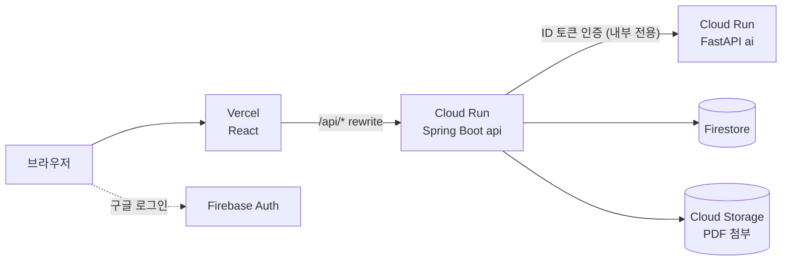

<!--
README 구성 원칙
1. 처음 온 사람이 위에서부터 읽으면 "무엇 → 어떻게 생겼나 → 어떻게 띄우나 → 어떻게 기여하나" 순서가 되게 한다.
2. 자주 바뀌는 상세 내용은 RULEBOOKS/로 보내고 README에는 요약과 링크만 둔다. (README가 길어지면 아무도 갱신하지 않는다)
3. 매년 운영진이 바뀌므로 "누구에게 물어보나"와 "외부 계정이 어디 있나"를 반드시 적는다.
-->

# GDGoC DGU Homepage

동국대학교 Google Developer Groups on Campus(GDGoC DGU) 공식 홈페이지입니다.

[](https://github.com/GDSC-DGU/GDGoC-DGU-Homepage/actions/workflows/ci.yml)
[](https://github.com/GDSC-DGU/GDGoC-DGU-Homepage/actions/workflows/deploy-production.yml)

| 환경 | 주소 | 배포 기준 |
|---|---|---|
| Production | https://gdgoc-dgu.com | `main` |
| Staging | https://dev.gdgoc-dgu.com (팀원 전용) | `develop` |

> 기본 브랜치는 `develop`입니다. 지금 보고 있는 코드는 production이 아니라 staging 기준입니다.

## 주요 기능

- 동아리 소개, 프로젝트·활동 아카이브, 커뮤니티 게시판, 일정 캘린더
- 지원서 제출과 AI 기반 서류 채점 보조
- 구글 로그인 기반 회원 기능 (General / Core / Lead 권한)
- 운영진용 관리자 페이지: 지원자 관리, 전형 결과 메일 일괄 발송, 회원 관리

## 아키텍처



- 브라우저는 api만 호출하며, ai는 외부에 공개되지 않습니다.
- 데이터를 쓰는 주체는 api 하나뿐입니다.
- 자세한 설계: `RULEBOOKS/architecture.md` (작성 예정)

## 기술 스택

| 영역 | 스택 | 패키지 관리 | 배포 |
|---|---|---|---|
| web | React, Vite, TypeScript | pnpm | Vercel |
| api | Spring Boot, Java | Gradle | Cloud Run (서울) |
| ai | FastAPI, Python | uv | Cloud Run (서울) |
| 계약 | OpenAPI 3 | — | — |
| 데이터 | Firestore, Cloud Storage, Firebase Auth | — | — |

## 레포 구조

```
apps/
  web/        React 프론트엔드
  api/        Spring Boot 백엔드
  ai/         FastAPI AI 서비스 (지원서 채점, 이후 챗봇)
packages/
  contracts/  API 계약 (openapi.yaml, ai-internal.yaml) ← 프론트·백엔드의 기준
infra/        Firestore rules·indexes, Storage 설정
scripts/      가짜 시드 데이터, 초기 세팅 스크립트
RULEBOOKS/    작업 규칙·설정·설계 문서 (요약: RULE_SUMMARY.md)
```

## 빠른 시작

### 준비물

| 도구 | 필요한 사람 |
|---|---|
| Docker Desktop | 전원 |
| Node.js (LTS), pnpm | web 담당 |
| JDK (버전은 `apps/api/build.gradle.kts` toolchain 참고) | api 담당 |
| uv | ai 담당 |

Java나 Python을 설치하지 않아도 Docker만 있으면 백엔드 전체를 띄울 수 있습니다.

### 실행

```bash
git clone https://github.com/GDSC-DGU/GDGoC-DGU-Homepage.git
cd GDGoC-DGU-Homepage
cp .env.example .env              # AI 키 등 값은 팀 내부 경로로 공유받아 채움

git switch -c feature/<작업>       # 작업 브랜치에서
./scripts/deploy.sh               # 로컬 전체 실행: 에뮬레이터(Firestore·Auth·Storage) + Mailpit + api + ai + web
```

| 주소 | 내용 |
|---|---|
| http://localhost:5173 | web |
| http://localhost:4000 | Firebase 에뮬레이터 UI (데이터 · 가짜 계정) |
| http://localhost:8025 | Mailpit (발송된 메일 확인, 실제로 나가지 않음) |

- `./scripts/deploy.sh`는 브랜치에 따라 다르게 동작합니다: 작업 브랜치 → 로컬 실행, `develop` → staging 배포, `main` → 실행 거부. Windows는 Git Bash 또는 WSL에서 실행합니다.
- 로컬 로그인은 Auth Emulator의 가짜 계정으로 합니다. 권한별 테스트 계정은 `scripts/seed`에 있습니다. AI 기능은 `.env`의 키로 실제 API를 호출합니다.
- 자세한 구성: [실행 · 배포 · 알림](RULEBOOKS/local-and-deploy.md)
- 앱별 상세 실행 방법: `apps/web`, `apps/api`, `apps/ai`의 README (앱 폴더를 만들 때 작성)

## 개발 흐름

1. 이슈 생성 (기능 / 디자인 / 버그 / 작업 / 문서 템플릿 → 종류 라벨 자동 부착)
2. `develop`에서 이슈 종류에 맞는 브랜치 생성 (`feature/`, `design/`, `fix/`, `task/`, `docs/`, 전부 소문자. 예: `feature/f-hom-001-hero-section`)
3. `develop`으로 PR → 승인 1명 + CI 통과 → 작성자가 squash merge
4. `develop`에서 `./scripts/deploy.sh`로 staging(dev.gdgoc-dgu.com) 배포 · 확인 (Write 이상 누구나)
5. Lead가 릴리스 PR(`develop` → `main`)을 머지하고 production 배포를 승인

규칙 문서는 모두 [`RULEBOOKS/`](RULEBOOKS/)에 있습니다. **처음이라면 [규칙 요약](RULEBOOKS/RULE_SUMMARY.md)부터 읽으세요.**

| 문서 | 내용 |
|---|---|
| [**규칙 요약**](RULEBOOKS/RULE_SUMMARY.md) | 모든 규칙을 한 페이지로 요약하고 자세한 문서로 연결 |
| [작업 규칙](RULEBOOKS/contributing.md) | 이슈 종류(라벨), 브랜치 이름, PR 제목, 작업 순서, 라벨 |
| [머지 규칙](RULEBOOKS/merge-rules.md) | 승인 조건, 리뷰 규칙, 릴리스, 핫픽스 |
| [레포 설정](RULEBOOKS/repo-settings.md) | Lead/PM용: 팀·권한, 레포·ruleset·환경 설정값 |
| [실행 · 배포 · 알림](RULEBOOKS/local-and-deploy.md) | 로컬 전체 실행, deploy.sh, 배포 workflow, Discord 알림 |
| 아키텍처 (작성 예정) | 시스템 구성, 인증 흐름, 비용 |
| 운영 런북 (작성 예정) | 배포 실패, 롤백, 지원 기간 체크리스트 |

기능 정의는 노션 명세서가 기준입니다. (팀원 전용)

## 외부 서비스 · 계정

운영진 교체 시 인수인계가 필요한 항목입니다. **소유 계정은 모두 동아리 공용 계정**입니다.

| 서비스 | 용도 | 관리자 |
|---|---|---|
| GitHub Organization (`GDSC-DGU`) | 코드, CI/CD, 담당 팀(`Homepage-FE` · `BE` · `AI` · `Lead/PM`) | Org Owner + 레포 Admin(`Homepage-Lead/PM` 팀). 기수 교체 시 팀 멤버 교체 |
| Vercel (Hobby) | 프론트 배포 (Git 연동 없이 GitHub Actions에서 CLI로 배포) | 동아리 공용 계정 |
| Google Cloud (dev / prod 프로젝트) | Cloud Run, Firestore, Storage | 동아리 공용 계정 |
| 도메인 `gdgoc-dgu.com` | — | 동아리 공용 계정 (갱신일: YYYY-MM-DD) |

## 보안

취약점은 공개 이슈 대신 [Security 탭의 비공개 제보](../../security/advisories/new)로 알려주세요.

## 만든 사람들

<!-- 기수별로 누적. 이름, 역할, GitHub 아이디 -->

| 기수 | 이름 | 역할 | GitHub |
|---|---|---|---|
| 2026 |  | Lead |  |
| 2026 |  | Web |  |
| 2026 |  | API |  |
| 2026 |  | AI |  |

## 라이선스

<!-- 2026-11-06 결정: 오픈소스 라이선스를 두지 않음. 바꾸려면 LICENSE 파일을 추가하고 이 절을 고칩니다. -->
이 레포에는 오픈소스 라이선스가 없습니다(All rights reserved). 코드는 공개되어 있어 누구나 볼 수 있지만, 허락 없이 복제·수정·배포할 수 없습니다. GitHub 이용약관에 따라 GitHub 안에서 보거나 포크하는 것은 가능합니다.

GDG·Google 로고와 브랜드 자산은 Google 브랜드 가이드라인을 따릅니다.
